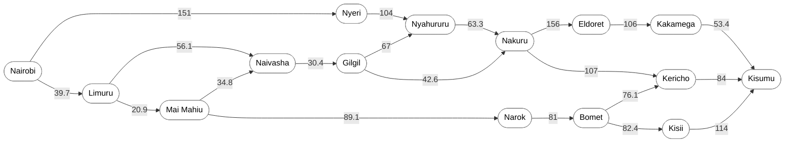
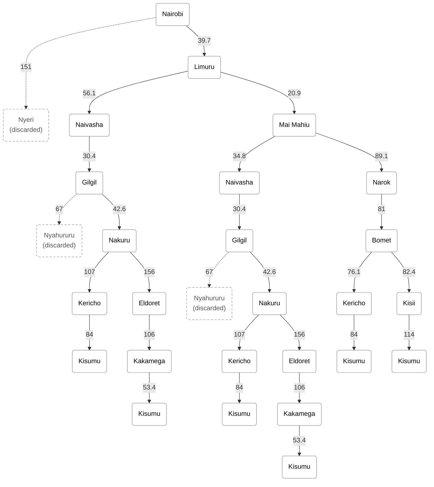

# Practical Exercise 3: Designing a Searching Agent

   **Group members:**
   - 183870 - Khillon Jayesh Makwana
   - 191608 - Nehemiah Joel Wanjala
   - 193428 - Suraj Kumar Menariya

## 1. PEAS Framework
### P – Performance Measure
- Travelling the shortest distance since the shorter the distance covered the less fuel consumed
- Delivery should be timely. There should be no delays.
- Speed limit, weight rules as well as traffic rules should be followed.
- Goods should be delivered safely and in good condition.
### E – Environment
- Other vehicles
- Weather
- Road conditions e.g., potholes
- Road construction or works going on
- Police checks
- Cargo itself
### A – Actuators
- Steering wheel
- Brakes
- Accelerator
- Vehicle horn
- Headlights and indicators
### S – Sensors
- Cameras
- LiDAR
- GPS
- Engine sensors
- Speedometer

## 2. Classifying the Environment
### Partially vs Fully Observable
- *Partially observable*. This is because the sensors don’t give all the information. The agent must make decisions based on experience as we also do not know the intentions of other drivers and the sensors cannot see round bends.
### Deterministic vs Stochastic
- *Stochastic*. This is because things like other drivers, weather conditions and breakdowns are beyond the agent’s control.
### Episodic vs Sequential
- *Sequential*. Each choice the agent makes will guide other future decisions. An example would be if you turn to Narok at Mai Mahiu then you will not use the Nakuru route.
### Static vs Dynamic
- *Dynamic*. As the agent is thinking, things like traffic and road conditions keep on changing.
### Single vs Multi-agent
- *Multi-agent*. The road is used by other agents as well such as other vehicles and traffic police. The self-driving trailer is not the only one.

## 3. Towns and Regions
| Town | Region | 
| --- | --- | 
| Nairobi | Nairobi |
| Ruiru | Nairobi | 
| Kiambu | Nairobi | 
| Limuru | Nairobi | 
| Thika | Central Highlands | 
| Nyeri | Central Highlands | 
| Nyahururu | Central Highlands | 
| Nanyuki | Central Highlands | 
| Meru | Central Highlands | 
| Embu | Central Highlands |
| Isiolo | Central Highlands |
| Naivasha | Rift Valley |
| Mai Mahiu | Rift Valley |
| Gilgil | Rift Valley |
| Nakuru | Rift Valley |
| Narok | Rift Valley |
| Bomet | Rift Valley | 
| Kericho | Rift Valley | 
| Eldoret | Rift Valley |
| Kisii | Lake Victoria Basin |
| Kakamega | Lake Victoria Basin | 
| Kisumu | Lake Victoria Basin | 

## 4. Costs (Distance in km)
| Road | Distance in km |
| --- | --- |
| Nairobi – Limuru | 39.7 |
| Limuru – Naivasha | 56.1 |
| Limuru – Mai Mahiu | 20.9 |
| Mai Mahiu – Naivasha | 34.8 |
| Mai Mahiu – Narok | 89.1 |
| Naivasha – Gilgil | 30.4 |
| Gilgil – Nakuru | 42.6 |
| Gilgil – Nyahururu | 67 |
| Nyahururu – Nakuru | 63.3 |
| Nairobi – Nyeri | 151 |
| Nyeri – Nyahururu | 104 |
| Narok – Bomet | 81 |
| Bomet – Kericho | 76.1 |
| Bomet – Kisii | 82.4 |
| Nakuru – Kericho | 107 |
| Kericho – Kisumu | 84 |
| Kisii – Kisumu | 114 |
| Nakuru – Eldoret | 156 |
| Eldoret – Kakamega | 106 |
| Kakamega – Kisumu | 53.4 |

## 5. Directed Graph

## 6. Search Tree

### Abstraction

Abstraction means leaving out information that does not help in solving the problem. We applied it in two ways.

- Some towns were left out of the graph and the tree. Ruiru, Kiambu, Thika, Nanyuki, Meru, Embu and Isiolo are all north or north-east of Nairobi. None of them has a road going west towards Kisumu, so the trailer would never pass through them on this trip. Adding them would only make the graph bigger without helping the agent.

- The Nyeri and Nyahururu branches were discarded in the tree. The roads exist, but they go north into the Central Highlands and then come back down to Nakuru. Going from Nairobi through Nyeri and Nyahururu to Nakuru is 151 + 104 + 63.3 = 318.3 km. The main road through Limuru, Naivasha and Gilgil gets to Nakuru in 39.7 + 56.1 + 30.4 + 42.6 = 168.8 km. Also, going from Gilgil to Nakuru through Nyahururu is 67 + 63.3 = 130.3 km, while the direct road from Gilgil to Nakuru is only 42.6 km.
Since both end up at Nakuru anyway and take a much longer road to get there, we did not expand them. They are shown in the tree as dashed boxes marked "(discarded)". 

## 7. Optimal Path Using Uniform Cost Search on the Search Tree

**Path cost function:** g(n) = total road distance (km) from Nairobi to node n.

### Stage 1
| | Path | g |
| --- | --- | --- |
| A | Nrb – Nyeri | 151 (discarded) |
| B | Nrb – Limuru | 39.7 |

### Stage 2
Lowest cost → B

| | Path | g |
| --- | --- | --- |
| A | Nrb – Nyeri | 151 (discarded) |
| B | Nrb – Limuru – Naivasha | 39.7 + 56.1 = 95.8 |
| C | Nrb – Limuru – Mai Mahiu | 39.7 + 20.9 = 60.6 |

### Stage 3
Lowest cost → C

| | Path | g |
| --- | --- | --- |
| A | Nrb – Nyeri | 151 (discarded) |
| B | Nrb – Limuru – Naivasha | 95.8 |
| C | Nrb – Limuru – Mai Mahiu – Naivasha | 60.6 + 34.8 = 95.4 |
| D | Nrb – Limuru – Mai Mahiu – Narok | 60.6 + 89.1 = 149.7 |

### Stage 4
Lowest cost → C

| | Path | g |
| --- | --- | --- |
| A | Nrb – Nyeri | 151 (discarded) |
| B | Nrb – Limuru – Naivasha | 95.8 |
| C | Nrb – Limuru – Mai Mahiu – Naivasha – Gilgil | 95.4 + 30.4 = 125.8 |
| D | Nrb – Limuru – Mai Mahiu – Narok | 149.7 |

### Stage 5
Lowest cost → B

| | Path | g |
| --- | --- | --- |
| A | Nrb – Nyeri | 151 (discarded) |
| B | Nrb – Limuru – Naivasha – Gilgil | 95.8 + 30.4 = 126.2 |
| C | Nrb – Limuru – Mai Mahiu – Naivasha – Gilgil | 125.8 |
| D | Nrb – Limuru – Mai Mahiu – Narok | 149.7 |

### Stage 6
Lowest cost → C

| | Path | g |
| --- | --- | --- |
| A | Nrb – Nyeri | 151 (discarded) |
| B | Nrb – Limuru – Naivasha – Gilgil | 126.2 |
| C | Nrb – Limuru – Mai Mahiu – Naivasha – Gilgil – Nyahururu | 125.8 + 67 = 192.8 (discarded) |
| D | Nrb – Limuru – Mai Mahiu – Naivasha – Gilgil – Nakuru | 125.8 + 42.6 = 168.4 |
| E | Nrb – Limuru – Mai Mahiu – Narok | 149.7 |

### Stage 7
Lowest cost → B

| | Path | g |
| --- | --- | --- |
| A | Nrb – Nyeri | 151 (discarded) |
| B | Nrb – Limuru – Naivasha – Gilgil – Nyahururu | 126.2 + 67 = 193.2 (discarded) |
| C | Nrb – Limuru – Naivasha – Gilgil – Nakuru | 126.2 + 42.6 = 168.8 |
| D | Nrb – Limuru – Mai Mahiu – Naivasha – Gilgil – Nyahururu | 192.8 (discarded) |
| E | Nrb – Limuru – Mai Mahiu – Naivasha – Gilgil – Nakuru | 168.4 |
| F | Nrb – Limuru – Mai Mahiu – Narok | 149.7 |

### Stage 8
Lowest cost → F

| | Path | g |
| --- | --- | --- |
| A | Nrb – Nyeri | 151 (discarded) |
| B | Nrb – Limuru – Naivasha – Gilgil – Nyahururu | 193.2 (discarded) |
| C | Nrb – Limuru – Naivasha – Gilgil – Nakuru | 168.8 |
| D | Nrb – Limuru – Mai Mahiu – Naivasha – Gilgil – Nyahururu | 192.8 (discarded) |
| E | Nrb – Limuru – Mai Mahiu – Naivasha – Gilgil – Nakuru | 168.4 |
| F | Nrb – Limuru – Mai Mahiu – Narok – Bomet | 149.7 + 81 = 230.7 |

### Stage 9
Lowest cost → E

| | Path | g |
| --- | --- | --- |
| A | Nrb – Nyeri | 151 (discarded) |
| B | Nrb – Limuru – Naivasha – Gilgil – Nyahururu | 193.2 (discarded) |
| C | Nrb – Limuru – Naivasha – Gilgil – Nakuru | 168.8 |
| D | Nrb – Limuru – Mai Mahiu – Naivasha – Gilgil – Nyahururu | 192.8 (discarded) |
| E | Nrb – Limuru – Mai Mahiu – Naivasha – Gilgil – Nakuru – Kericho | 168.4 + 107 = 275.4 |
| F | Nrb – Limuru – Mai Mahiu – Naivasha – Gilgil – Nakuru – Eldoret | 168.4 + 156 = 324.4 |
| G | Nrb – Limuru – Mai Mahiu – Narok – Bomet | 230.7 |

### Stage 10
Lowest cost → C

| | Path | g |
| --- | --- | --- |
| A | Nrb – Nyeri | 151 (discarded) |
| B | Nrb – Limuru – Naivasha – Gilgil – Nyahururu | 193.2 (discarded) |
| C | Nrb – Limuru – Naivasha – Gilgil – Nakuru – Kericho | 168.8 + 107 = 275.8 |
| D | Nrb – Limuru – Naivasha – Gilgil – Nakuru – Eldoret | 168.8 + 156 = 324.8 |
| E | Nrb – Limuru – Mai Mahiu – Naivasha – Gilgil – Nyahururu | 192.8 (discarded) |
| F | Nrb – Limuru – Mai Mahiu – Naivasha – Gilgil – Nakuru – Kericho | 275.4 |
| G | Nrb – Limuru – Mai Mahiu – Naivasha – Gilgil – Nakuru – Eldoret | 324.4 |
| H | Nrb – Limuru – Mai Mahiu – Narok – Bomet | 230.7 |

### Stage 11
Lowest cost → H

| | Path | g |
| --- | --- | --- |
| A | Nrb – Nyeri | 151 (discarded) |
| B | Nrb – Limuru – Naivasha – Gilgil – Nyahururu | 193.2 (discarded) |
| C | Nrb – Limuru – Naivasha – Gilgil – Nakuru – Kericho | 275.8 |
| D | Nrb – Limuru – Naivasha – Gilgil – Nakuru – Eldoret | 324.8 |
| E | Nrb – Limuru – Mai Mahiu – Naivasha – Gilgil – Nyahururu | 192.8 (discarded) |
| F | Nrb – Limuru – Mai Mahiu – Naivasha – Gilgil – Nakuru – Kericho | 275.4 |
| G | Nrb – Limuru – Mai Mahiu – Naivasha – Gilgil – Nakuru – Eldoret | 324.4 |
| H | Nrb – Limuru – Mai Mahiu – Narok – Bomet – Kericho | 230.7 + 76.1 = 306.8 |
| I | Nrb – Limuru – Mai Mahiu – Narok – Bomet – Kisii | 230.7 + 82.4 = 313.1 |

### Stage 12
Lowest cost → F

| | Path | g |
| --- | --- | --- |
| A | Nrb – Nyeri | 151 (discarded) |
| B | Nrb – Limuru – Naivasha – Gilgil – Nyahururu | 193.2 (discarded) |
| C | Nrb – Limuru – Naivasha – Gilgil – Nakuru – Kericho | 275.8 |
| D | Nrb – Limuru – Naivasha – Gilgil – Nakuru – Eldoret | 324.8 |
| E | Nrb – Limuru – Mai Mahiu – Naivasha – Gilgil – Nyahururu | 192.8 (discarded) |
| F | Nrb – Limuru – Mai Mahiu – Naivasha – Gilgil – Nakuru – Kericho – Kisumu | 275.4 + 84 = 359.4 (reached Kisumu) |
| G | Nrb – Limuru – Mai Mahiu – Naivasha – Gilgil – Nakuru – Eldoret | 324.4 |
| H | Nrb – Limuru – Mai Mahiu – Narok – Bomet – Kericho | 306.8 |
| I | Nrb – Limuru – Mai Mahiu – Narok – Bomet – Kisii | 313.1 |

### Stage 13
Lowest cost → C

| | Path | g |
| --- | --- | --- |
| A | Nrb – Nyeri | 151 (discarded) |
| B | Nrb – Limuru – Naivasha – Gilgil – Nyahururu | 193.2 (discarded) |
| C | Nrb – Limuru – Naivasha – Gilgil – Nakuru – Kericho – Kisumu | 275.8 + 84 = 359.8 (reached Kisumu) |
| D | Nrb – Limuru – Naivasha – Gilgil – Nakuru – Eldoret | 324.8 |
| E | Nrb – Limuru – Mai Mahiu – Naivasha – Gilgil – Nyahururu | 192.8 (discarded) |
| F | Nrb – Limuru – Mai Mahiu – Naivasha – Gilgil – Nakuru – Kericho – Kisumu | 359.4 (reached Kisumu) |
| G | Nrb – Limuru – Mai Mahiu – Naivasha – Gilgil – Nakuru – Eldoret | 324.4 |
| H | Nrb – Limuru – Mai Mahiu – Narok – Bomet – Kericho | 306.8 |
| I | Nrb – Limuru – Mai Mahiu – Narok – Bomet – Kisii | 313.1 |

### Stage 14
Lowest cost → H

| | Path | g |
| --- | --- | --- |
| A | Nrb – Nyeri | 151 (discarded) |
| B | Nrb – Limuru – Naivasha – Gilgil – Nyahururu | 193.2 (discarded) |
| C | Nrb – Limuru – Naivasha – Gilgil – Nakuru – Kericho – Kisumu | 359.8 (reached Kisumu) |
| D | Nrb – Limuru – Naivasha – Gilgil – Nakuru – Eldoret | 324.8 |
| E | Nrb – Limuru – Mai Mahiu – Naivasha – Gilgil – Nyahururu | 192.8 (discarded) |
| F | Nrb – Limuru – Mai Mahiu – Naivasha – Gilgil – Nakuru – Kericho – Kisumu | 359.4 (reached Kisumu) |
| G | Nrb – Limuru – Mai Mahiu – Naivasha – Gilgil – Nakuru – Eldoret | 324.4 |
| H | Nrb – Limuru – Mai Mahiu – Narok – Bomet – Kericho – Kisumu | 306.8 + 84 = 390.8 (reached Kisumu) |
| I | Nrb – Limuru – Mai Mahiu – Narok – Bomet – Kisii | 313.1 |

### Stage 15
Lowest cost → I

| | Path | g |
| --- | --- | --- |
| A | Nrb – Nyeri | 151 (discarded) |
| B | Nrb – Limuru – Naivasha – Gilgil – Nyahururu | 193.2 (discarded) |
| C | Nrb – Limuru – Naivasha – Gilgil – Nakuru – Kericho – Kisumu | 359.8 (reached Kisumu) |
| D | Nrb – Limuru – Naivasha – Gilgil – Nakuru – Eldoret | 324.8 |
| E | Nrb – Limuru – Mai Mahiu – Naivasha – Gilgil – Nyahururu | 192.8 (discarded) |
| F | Nrb – Limuru – Mai Mahiu – Naivasha – Gilgil – Nakuru – Kericho – Kisumu | 359.4 (reached Kisumu) |
| G | Nrb – Limuru – Mai Mahiu – Naivasha – Gilgil – Nakuru – Eldoret | 324.4 |
| H | Nrb – Limuru – Mai Mahiu – Narok – Bomet – Kericho – Kisumu | 390.8 (reached Kisumu) |
| I | Nrb – Limuru – Mai Mahiu – Narok – Bomet – Kisii – Kisumu | 313.1 + 114 = 427.1 (reached Kisumu) |

### Stage 16
Lowest cost → G

| | Path | g |
| --- | --- | --- |
| A | Nrb – Nyeri | 151 (discarded) |
| B | Nrb – Limuru – Naivasha – Gilgil – Nyahururu | 193.2 (discarded) |
| C | Nrb – Limuru – Naivasha – Gilgil – Nakuru – Kericho – Kisumu | 359.8 (reached Kisumu) |
| D | Nrb – Limuru – Naivasha – Gilgil – Nakuru – Eldoret | 324.8 |
| E | Nrb – Limuru – Mai Mahiu – Naivasha – Gilgil – Nyahururu | 192.8 (discarded) |
| F | Nrb – Limuru – Mai Mahiu – Naivasha – Gilgil – Nakuru – Kericho – Kisumu | 359.4 (reached Kisumu) |
| G | Nrb – Limuru – Mai Mahiu – Naivasha – Gilgil – Nakuru – Eldoret – Kakamega | 324.4 + 106 = 430.4 |
| H | Nrb – Limuru – Mai Mahiu – Narok – Bomet – Kericho – Kisumu | 390.8 (reached Kisumu) |
| I | Nrb – Limuru – Mai Mahiu – Narok – Bomet – Kisii – Kisumu | 427.1 (reached Kisumu) |

### Stage 17
Lowest cost → D

| | Path | g |
| --- | --- | --- |
| A | Nrb – Nyeri | 151 (discarded) |
| B | Nrb – Limuru – Naivasha – Gilgil – Nyahururu | 193.2 (discarded) |
| C | Nrb – Limuru – Naivasha – Gilgil – Nakuru – Kericho – Kisumu | 359.8 (reached Kisumu) |
| D | Nrb – Limuru – Naivasha – Gilgil – Nakuru – Eldoret – Kakamega | 324.8 + 106 = 430.8 |
| E | Nrb – Limuru – Mai Mahiu – Naivasha – Gilgil – Nyahururu | 192.8 (discarded) |
| F | Nrb – Limuru – Mai Mahiu – Naivasha – Gilgil – Nakuru – Kericho – Kisumu | 359.4 (reached Kisumu) |
| G | Nrb – Limuru – Mai Mahiu – Naivasha – Gilgil – Nakuru – Eldoret – Kakamega | 430.4 |
| H | Nrb – Limuru – Mai Mahiu – Narok – Bomet – Kericho – Kisumu | 390.8 (reached Kisumu) |
| I | Nrb – Limuru – Mai Mahiu – Narok – Bomet – Kisii – Kisumu | 427.1 (reached Kisumu) |

### Stage 18
Lowest cost → G

| | Path | g |
| --- | --- | --- |
| A | Nrb – Nyeri | 151 (discarded) |
| B | Nrb – Limuru – Naivasha – Gilgil – Nyahururu | 193.2 (discarded) |
| C | Nrb – Limuru – Naivasha – Gilgil – Nakuru – Kericho – Kisumu | 359.8 (reached Kisumu) |
| D | Nrb – Limuru – Naivasha – Gilgil – Nakuru – Eldoret – Kakamega | 430.8 |
| E | Nrb – Limuru – Mai Mahiu – Naivasha – Gilgil – Nyahururu | 192.8 (discarded) |
| F | Nrb – Limuru – Mai Mahiu – Naivasha – Gilgil – Nakuru – Kericho – Kisumu | 359.4 (reached Kisumu) |
| G | Nrb – Limuru – Mai Mahiu – Naivasha – Gilgil – Nakuru – Eldoret – Kakamega – Kisumu | 430.4 + 53.4 = 483.8 (reached Kisumu) |
| H | Nrb – Limuru – Mai Mahiu – Narok – Bomet – Kericho – Kisumu | 390.8 (reached Kisumu) |
| I | Nrb – Limuru – Mai Mahiu – Narok – Bomet – Kisii – Kisumu | 427.1 (reached Kisumu) |

### Stage 19
Lowest cost → D

| | Path | g |
| --- | --- | --- |
| A | Nrb – Nyeri | 151 (discarded) |
| B | Nrb – Limuru – Naivasha – Gilgil – Nyahururu | 193.2 (discarded) |
| C | Nrb – Limuru – Naivasha – Gilgil – Nakuru – Kericho – Kisumu | 359.8 (reached Kisumu) |
| D | Nrb – Limuru – Naivasha – Gilgil – Nakuru – Eldoret – Kakamega – Kisumu | 430.8 + 53.4 = 484.2 (reached Kisumu) |
| E | Nrb – Limuru – Mai Mahiu – Naivasha – Gilgil – Nyahururu | 192.8 (discarded) |
| F | Nrb – Limuru – Mai Mahiu – Naivasha – Gilgil – Nakuru – Kericho – Kisumu | 359.4 (reached Kisumu) |
| G | Nrb – Limuru – Mai Mahiu – Naivasha – Gilgil – Nakuru – Eldoret – Kakamega – Kisumu | 483.8 (reached Kisumu) |
| H | Nrb – Limuru – Mai Mahiu – Narok – Bomet – Kericho – Kisumu | 390.8 (reached Kisumu) |
| I | Nrb – Limuru – Mai Mahiu – Narok – Bomet – Kisii – Kisumu | 427.1 (reached Kisumu) |

All paths have now either reached Kisumu or been discarded, so the search ends.

### Comparing the paths that reached Kisumu

| Path | g |
| --- | --- |
| **F – Nrb – Limuru – Mai Mahiu – Naivasha – Gilgil – Nakuru – Kericho – Kisumu** | **359.4** |
| C – Nrb – Limuru – Naivasha – Gilgil – Nakuru – Kericho – Kisumu | 359.8 |
| H – Nrb – Limuru – Mai Mahiu – Narok – Bomet – Kericho – Kisumu | 390.8 |
| I – Nrb – Limuru – Mai Mahiu – Narok – Bomet – Kisii – Kisumu | 427.1 |
| G – Nrb – Limuru – Mai Mahiu – Naivasha – Gilgil – Nakuru – Eldoret – Kakamega – Kisumu | 483.8 |
| D – Nrb – Limuru – Naivasha – Gilgil – Nakuru – Eldoret – Kakamega – Kisumu | 484.2 |

### Optimal Path
**Nairobi → Limuru → Mai Mahiu → Naivasha → Gilgil → Nakuru → Kericho → Kisumu**

**Path cost = 39.7 + 20.9 + 34.8 + 30.4 + 42.6 + 107 + 84 = 359.4 km**

## 8. Evidence
